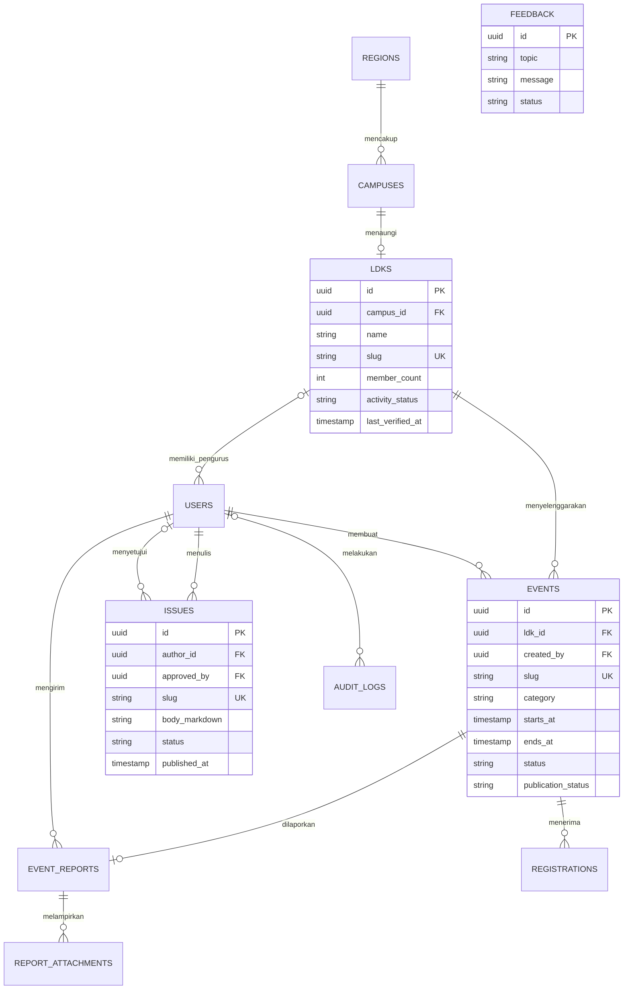

# Rancangan portal FSLDK

## Cakupan implementasi

Satu aplikasi React + TypeScript + Vite, dua layout terpisah. Ini starter yang dapat dijalankan: halaman publik, filter dan kalender agenda, detail agenda, dialog simulasi registrasi, isu dan artikel, profil, kontak, serta dashboard monitoring. Dashboard memiliki tambah/perbarui kegiatan, laporan teks, tautan dokumentasi, pencarian direktori, dan simulasi dua peran. Data hanya berada di memori sesi; refresh mengembalikan seed. Tidak ada autentikasi, API, unggahan, email, atau database yang berjalan pada contoh ini.

Domain publik dan dashboard dipisahkan melalui fitur dan route, sehingga tidak perlu menduplikasi aplikasi atau memasang dua frontend. Modul dashboard dimuat dengan `React.lazy`. Bila nanti perlu deployment terpisah, masing-masing layout dapat menjadi entry aplikasi dengan komponen bersama tetap dipakai.

## Struktur yang sudah tersedia

```text
src/
  app/
    App.tsx                  # route dan lazy loading dashboard
    PublicLayout.tsx         # navigasi, footer, identitas
  components/ui/
    Modal.tsx                # primitive Radix, fokus dan Escape
  features/
    public/
      Home.tsx               # komposisi landing
      Hero.tsx               # hero navy, foto, overlay agenda
      CampusMarquee.tsx      # nama kampus dalam grid responsif
      PortalUpdates.tsx      # perbandingan pembaruan dan FAQ
      Pages.tsx              # profil, kontak, 404
    events/
      AgendaCard.tsx         # komponen kartu reusable
      Events.tsx             # filter, kalender, detail, registrasi demo
    issues/
      IssueSection.tsx       # blok editorial landing
      Issues.tsx             # daftar dan detail tulisan
    dashboard/
      DashboardLayout.tsx    # sidebar, cakupan demo, provider
      Dashboard.tsx          # ringkasan, monitoring, direktori
      model.ts               # tipe, validasi, filter cakupan
  data/demo.ts               # seed dan formatter tanggal WIB
  main.tsx
  styles.css                 # token dan primitive Tailwind
database/schema.sql          # rancangan SQL PostgreSQL
tests/dashboard.test.mjs      # validasi dan cakupan data
docs/architecture.md
```

Saat integrasi backend, tambah `src/lib/api.ts` untuk HTTP terpusat serta `server/modules/{auth,ldks,events,issues,feedback}` untuk domain API. Belum dibuat supaya starter tidak menyertakan lapisan kosong. Backend yang disarankan: Node.js + PostgreSQL; penyimpanan dokumen di object storage privat. Server menggunakan satu service modular; belum membutuhkan microservices.

## Peta halaman

| URL | Perilaku |
| --- | --- |
| `/` | Hero, statistik seed, agenda unggulan, isu, ajakan kolaborasi |
| `/about` dan `/about#jejaring` | Rancangan sejarah, visi/misi, komisi, kampus |
| `/events` | Filter Kajian/Training/Musda, kartu dan kalender bulanan |
| `/e/:slug` | Detail dan dialog registrasi demo |
| `/issues` dan `/i/:slug` | Daftar dan pembaca artikel |
| `/contact` | Form simulasi pesan dan tempat saluran resmi |
| `/dashboard` | Ringkasan menurut cakupan peran demo |
| `/dashboard/activities` | Tambah/perbarui, status, laporan, dokumentasi |
| `/dashboard/ldks` | Direktori, jumlah kader, keaktifan, pencarian |

## Relasi data



Asumsi: satu LDK per kampus, banyak akun pengurus per LDK. Admin pusat tidak memiliki `ldk_id`. Feedback dapat dikirim pengunjung tanpa akun. Jika struktur organisasi membolehkan beberapa LDK per kampus, hapus unique `campus_id` setelah kesepakatan domain.

`events` adalah sumber kegiatan internal sekaligus calon agenda publik. Status pelaksanaan (`planned/ongoing/completed/cancelled`) terpisah dari publikasi (`draft/pending/published/rejected`). Kegiatan internal tidak otomatis muncul di publik. Satu laporan ringkas per kegiatan, banyak lampiran. `member_count` adalah agregat, bukan data pribadi tiap kader; histori jumlah kader memerlukan snapshot periode bila kelak diminta.

SQL memuat FK, check, unique email case-insensitive, indeks, dan trigger `updated_at`. SQL adalah rancangan migrasi awal, belum dieksekusi. UUID seed frontend disederhanakan menjadi string untuk keterbacaan; API memakai UUID asli. Aturan lintas tabel berikut wajib berada di transaksi service: kepemilikan laporan, laporan wajib sebelum status selesai, reviewer admin, dan kuota registrasi. FK saja tidak menegakkan aturan tersebut.

## Auth dan otorisasi produksi

| Operasi | Pengunjung | Pengurus LDK | Admin Pusat |
| --- | --- | --- | --- |
| Baca agenda/isu published | Ya | Ya | Ya |
| Registrasi, kirim pesan | Ya | Ya | Ya |
| Baca monitoring | Tidak | LDK sendiri | Semua LDK |
| Buat/ubah kegiatan dan laporan | Tidak | LDK sendiri | Semua LDK |
| Ubah jumlah kader/profil | Tidak | LDK sendiri | Semua LDK |
| Kelola akun dan publish/review | Tidak | Tidak | Ya |
| Baca pengaduan | Tidak | Tidak | Ya |

Rancangan alur: akun pengurus diundang admin → login → sesi cookie `HttpOnly`, `Secure`, `SameSite=Lax` → route dashboard → API memeriksa sesi dan peran setiap request. Password disimpan sebagai hash Argon2id. Sesi disimpan di server dengan token acak yang di-hash, expiry, rotasi, dan pencabutan saat logout. Tidak menaruh token login di localStorage. Mutasi memakai proteksi CSRF dan validasi Origin. Login dibatasi laju; reset password memakai token sekali pakai dengan masa berlaku.

Server menentukan `ldk_id` dari sesi untuk pengurus, bukan dari body request. Setiap query pengurus menyertakan `WHERE ldk_id = session.ldk_id`, termasuk report, attachment, statistik, dan ekspor. Route guard frontend hanya mengatur pengalaman pengguna; API tetap menjadi batas akses. Daftar publik tidak mengembalikan email registran, draf, laporan privat, atau pengaduan. Uji percobaan mengakses UUID milik kampus lain pada semua endpoint. Aksi admin dan perubahan data penting masuk audit log tanpa isi sensitif pesan.

## Kontrak API yang direncanakan

| Endpoint | Akses / validasi |
| --- | --- |
| `POST /api/v1/auth/login`, `/logout` | Publik/login; sesi dan rate limit |
| `GET /api/v1/auth/me` | Sesi; identitas dan role |
| `GET /api/v1/events?category=&month=&cursor=` | Publik; hanya published |
| `GET /api/v1/events/:slug` | Publik; published atau 404 |
| `POST /api/v1/events/:id/registrations` | Publik; persetujuan, cutoff, deduplikasi, kapasitas |
| `GET /api/v1/issues`, `/issues/:slug` | Publik; hanya published |
| `POST /api/v1/feedback` | Publik; batas pesan, rate limit, antispam |
| `GET /api/v1/monitoring/summary` | Sesi; agregat sesuai cakupan |
| `GET/POST /api/v1/monitoring/events` | Sesi; cakupan LDK |
| `PATCH /api/v1/monitoring/events/:id` | Pemilik/admin; versi untuk cegah lost update |
| `PUT /api/v1/monitoring/events/:id/report` | Pemilik/admin; ringkasan dan peserta |
| `POST /api/v1/monitoring/reports/:id/attachments` | Pemilik/admin; signed upload URL |
| `GET/PATCH /api/v1/ldks/:id` | Cakupan sesi; field yang diizinkan |
| `POST /api/v1/admin/events/:id/publish` | Admin; review dan audit |
| `POST/PATCH /api/v1/admin/issues[/:id]` | Admin; draf dan publikasi editorial |
| `GET/PATCH /api/v1/admin/feedback[/:id]` | Admin; tindak lanjut pengaduan |

Gunakan respons `{ data, nextCursor }` dan error `{ code, message, fields }`. Invalid input `422`, tidak login `401`, akses terlarang `403`, resource tidak terlihat `404`, kuota/konflik versi `409`. Registrasi mengunci baris event (`SELECT ... FOR UPDATE`), menghitung confirmed, lalu insert dalam satu transaksi. Unique index mencegah email ganda. Tanggal disimpan sebagai `timestamptz`, tampil WIB. Kegiatan selesai dan laporan disimpan atomik.

Dokumentasi produksi: bucket privat, izin unduh per LDK, validasi MIME/signature/ukuran file dan signed URL singkat. Hanya gambar JPEG/PNG/WebP dan PDF hingga batas yang disepakati; metadata file tersimpan di DB. Hindari SVG aktif. Render Markdown editorial tanpa HTML mentah, sanitasi jika HTML diizinkan. Browser demo hanya menerima tautan HTTPS dan membuka tab baru dengan `noopener noreferrer`.

## Desain komponen

| Komponen | Tanggung jawab dan keputusan |
| --- | --- |
| Hero | Deep navy, aksen sky-blue, foto arsip pengurus FSLDK lokal, overlay agenda kaca, statistik seed |
| CampusMarquee | Enam nama kampus dalam grid statis responsif, tanpa label dekoratif atau tombol jeda |
| AgendaCard | Props `event`; penyelenggara, kategori, tanggal WIB, lokasi, tautan detail |
| IssueSection | Satu artikel utama dan satu sekunder; hirarki editorial, teks nyaman dibaca |
| DashboardLayout | Sidebar responsif, header cakupan, outlet, konteks simulasi sesi |
| Modal | Primitive Radix; judul/deskripsi, focus trap, Escape, restore focus |

Contoh implementasi lengkap ada di file tersebut, bukan pseudocode. React Router menghubungkan URL publik dan dashboard. Tailwind memakai plugin Vite dan `@theme`; tidak memerlukan konfigurasi Tailwind v3. Framer Motion digunakan untuk fade hero dengan `MotionConfig reducedMotion="user"`.

Palet: off-white `#f8fafc`, border `rgba(0,0,0,0.06)`, navy `#0f2b48`, royal blue `#1d68a8`, serta emerald `#059669` untuk indikator positif. Kontainer fluid `calc(100% - clamp(32px, 4vw, 96px))` tanpa batas lebar desktop; gutter mobile 16px dan padding section 40px/64px. Hero dan navbar beranda menyatu pada deep navy `#0c1a2e`, dengan aksen sky-blue dan radial spotlight halus tanpa blur blob. Foto arsip pengurus dan dua dokumentasi pelantikan dari situs FSLDK Baraya disajikan lokal; sumber dicatat di `public/images/README.md`. Galeri di beranda dan profil mendukung dialog perbesar dan lazy loading. Kartu agenda memiliki latar navy semi-transparan dan backdrop blur terbatas pada kartu. Pita jejaring berisi ITB, UNPAD, UPI, TELKOM UNIVERSITY, UIN SGD, dan POLBAN; daftar nama ini tidak mengubah jumlah LDK pada seed. Pita nama kampus kini statis sesuai revisi UI terbaru. Strip prototipe di atas navbar dihapus; cakupan demo tetap dijelaskan pada footer. Plus Jakarta Sans memiliki fallback sistem; font eksternal tidak menghalangi interaksi. Grid berubah dari satu kolom ke komposisi bento desktop. Tidak ada blob blur, gradient pelangi, progress bar skill, atau section non-hero setinggi layar. Tombol dan input minimal 44px; focus ring, skip link, landmark, label, status/error, reduced motion, dan overflow tabel/kalender disediakan.

## Jalur menuju produksi

1. Validasi nama wilayah, logo, sejarah, struktur komisi, kontak, serta isi resmi. Semua seed saat ini ilustrasi.
2. Jalankan migrasi PostgreSQL pada database pengembangan, bangun auth/API, kemudian ganti sumber demo dengan HTTP. Tambahkan pengujian integrasi FK, transaksi registrasi, RBAC lintas kampus, sesi, CSRF, dan upload.
3. Tambahkan loading/error/empty state API dan invalidasi data setelah mutasi. Uji keyboard, pembaca layar, serta viewport 375/768/1024/1440.
4. Prerender halaman publik atau pindahkan layout publik ke SSR bila dibutuhkan indeks berita dan social preview per artikel. SPA starter belum menghasilkan metadata per artikel di HTML server.
5. Deploy aset `dist/` lewat CDN, cache file hash, rewrite route non-aset ke `index.html`. Letakkan `/api` di origin yang sama. Lindungi database, simpan secret hanya di server, atur backup dan kebijakan retensi registrasi/pengaduan.

## Referensi implementasi

- [Situs acuan FSLDK Baraya](https://fsldk-baraya.my.id/): dapat diakses, tetapi alat penelusuran tidak mendapatkan konten teks; alur di starter mengikuti spesifikasi pengguna, belum hasil audit visual situs.
- [Tailwind dengan Vite](https://tailwindcss.com/docs/installation/using-vite).
- [React Router BrowserRouter](https://reactrouter.com/api/declarative-routers/BrowserRouter).
- [Radix Dialog](https://www.radix-ui.com/primitives/docs/components/dialog): fokus, label, dan Escape.
- [MotionConfig](https://motion.dev/docs/react-motion-config): reduced motion sesuai perangkat.

Evaluasi UI terbaru, perbaikan responsivitas, dan keterbatasan produksi: [ui-review.md](ui-review.md).

Audit terbaru atas HTML dan aset referensi beserta batas kesimpulannya: [reference-audit.md](reference-audit.md).
